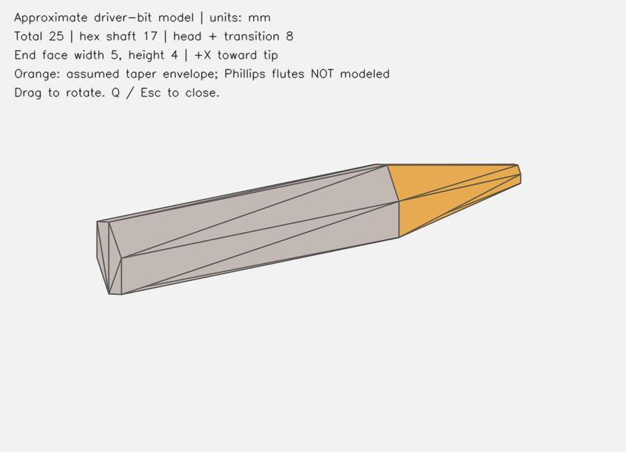

# RK3568 单目批头6D位姿实验

Ubuntu 22.04 / ROS2 Humble 与 RK3568 / Buildroot 的单目感知学习项目。
当前业务链路是**带 ArUco 标记辅助的批头定位**，不是裸金属批头的自动6D识别。

## 当前完成情况

- ROS2 C++节点：图像和相机内参输入，ArUco/PnP，PoseStamped、TF及调试图输出。
- 板端独立C++程序：MIPI/V4L2 4K NV12采集，RGA缩图，指定ID检测，原4K角点精修与PnP。
- 固定组件：`T_camera_object = T_camera_marker * T_marker_object`，实时批头近似线框投影。
- ChArUco标定工具、静态与运动诊断、丢失/恢复检查、候选位姿回放。
- 批头参数模型：总长25 mm，杆身17 mm，刀头包络8 mm，对角宽5 mm，对边高4 mm。

ID42是固定的图案编号；位置/旋转变化不会生成新ID。ChArUco由多个带ID的ArUco标记和棋盘角点构成。

## 目录

| 路径 | 内容 |
|---|---|
| `src/monocular_6d_pose` | ROS2节点、launch、配置及C++测试 |
| `native/src/main.cpp` | RK3568原生实时采集与位姿程序 |
| `native/calibration_desktop.py` | 桌面标定工具 |
| `native/part/models/bit-v02` | 批头STL、OBJ、OpenSCAD模型及假设 |
| `native/part/build_bit_model.py` | 参数化模型生成器 |
| `native/part/assembly_marker42_gap13_preview.json` | 当前安装参数及预览网格 |
| `native/part/bit_marker42_20mm_mount_A4.pdf` | A4、100%打印的20 mm标记模板 |
| `docs/` | 使用、验证与实测记录 |



## Ubuntu学习与ROS2演示

```bash
sudo apt install python3-opencv python3-numpy python3-scipy
cd native/part
python3 view_model.py
# 无GUI输出模型预览
python3 view_model.py --output model-preview.png
# 输出新模型目录，已有目录不会覆盖
python3 build_bit_model.py --output models/my-bit
```

ROS2工作空间根目录运行：

```bash
source /opt/ros/humble/setup.bash
colcon build --symlink-install --cmake-args -DCMAKE_BUILD_TYPE=Release
source install/setup.bash
ros2 launch monocular_6d_pose demo.launch.py
```

ROS2演示与板端独立程序是两条运行路径；板端实测系统未安装ROS2。

## 板端构建与运行

详见 `native/README.md`、`native/DEPENDENCIES.txt` 和 `RK3568.md`。
交叉构建需要 ARM64工具链、OpenCV/contrib 4.5.5源码，以及与目标板匹配的RGA头文件和动态库。
这些第三方源码包、SDK、工具链和板端二进制未纳入本源码仓；系统驱动须使用厂商匹配版本。

```bash
# 在配置好cross/依赖的Ubuntu中
bash native/build_cross.sh
# 在开发板部署目录中；pose6d为上述构建产物
./pose6d --self-test --rga
POSE6D_BINARY=./pose6d POSE6D_LABEL='BIT model - measured gap 13mm' \
python3 view_live.py --width 1280 --height 720 \
  --calibration calibration/camera.yaml \
  --assembly part/assembly_marker42_gap13_preview.json --output /dev/null
```

同一时刻只允许一个相机采集进程。`--frames 0`为持续采集；记录图像须指定有界帧数。
相机示例内参仅适用于原实验设备和分辨率，换设备必须重新标定。
板端OpenCV 4.5.5 FileStorage不接受JSON null；运行用安装配置避免null值。

## 安装参数与模型边界

标记黑框边长20 mm。用户量得黑框下沿到批头长轴中心线13 mm，故标记中心到批头中心线23 mm。
当前平移 `[0, -0.023, 0.002]` 米；X居中、Z=2 mm和轴方向仍是名义假设。
`mount_independently_verified=0`，不能当成完整精密安装标定。

STL/OBJ单位是毫米。十字槽未实测，刀头采用近似锥缩包络；不能作为精密机械图纸或已验证的裸物体配准模型。
批头必须与标记刚性固定；胶带松动、批头滚动或纸张弯曲都会破坏换算关系。

## 实验结果与精度边界

2026-10-26较明显倾斜静态检查：240帧中237帧通过位姿质量检查，3帧拒绝。
相邻有效输出无大于10度变化；XYZ短时标准差约0.200/0.112/0.855 mm。
这是输出重复性记录，**不是绝对精度**，也不是纯运动识别准确率。
近平视姿态仍有跳变，未用滤波掩盖；RGA已使用，NPU未使用，不声称已榨干全部硬件性能。

完整精度验证还需要：实测安装六维变换；独立已知位置/角度真值与测量误差；
多距离、多方向、画面不同区域的重复实验；机器人抓取还需要手眼标定及基座坐标验证。
重投影误差、重复性、绝对位置/角度误差须分开报告。详见 `docs/VALIDATION_CN.md`。

本仓保留源码、模型、打印模板和必要参数；不包含密钥、登录信息、原始室内照片、完整采集数据及构建缓存。
